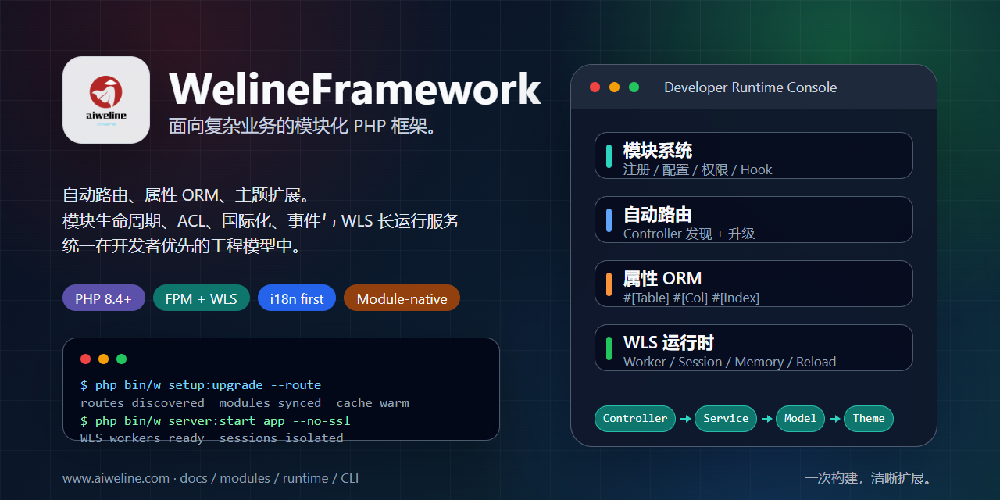

# WelineFramework



**WelineFramework** 是 PHP 8.4+ 模块化业务框架。招牌运行时 **WLS** 让应用**常驻内存**——HTTP Worker、Session Server、Memory Server 与热重载——同时传统 FPM 仍是一等部署路径。

[官网](https://www.aiweline.com) ·
[开发者入口](./dev/docs/weline/开发者入口.md) ·
[文档](./dev/docs/README.md) ·
[架构](./dev/docs/weline/README.md) ·
[WLS](./app/code/Weline/Server/doc/README.md) ·
[多语言 README](./dev/docs/readme/README.md) ·
[AI 工程入口](./AGENTS.md)


[English](./README.md) |
[简体中文](./README.zh-CN.md) |
[日本語](./dev/docs/readme/README.ja.md) |
[한국어](./dev/docs/readme/README.ko.md) |
[Deutsch](./dev/docs/readme/README.de.md) |
[Français](./dev/docs/readme/README.fr.md) |
[更多语言](./dev/docs/readme/README.md)

---

WelineFramework 把模块生命周期、自动路由、属性驱动 ORM、事件/Hook、后台 ACL、主题、i18n 与 CLI 放进同一套工程模型，让业务能力以可安装、可升级的模块交付。

### WLS 与 FPM

| | **WLS**（招牌能力） | **FPM**（同样一等） |
|---|---|---|
| 模型 | 长驻内存的框架运行时 | 经典请求 / 进程模型 |
| 启动 | `php bin/w server:start` | Nginx/Apache + php-fpm |
| 能力 | HTTP Worker、Session/Memory、维护 Worker、热重载、运行时治理 | 熟悉的传统 PHP 部署 |

> WLS 是**框架运行时**，不是通用 HTTP 调试入口。需要常驻 Worker 与进程内服务时用 WLS；需要经典栈时用 FPM。

## 能力全景

WelineFramework 不只是一个 PHP 运行时：域名、CDN、商城、邮件、SEO、AI 运营和自动部署都以可安装模块交付。

- **域名到 HTTPS** — 域名池、注册商适配（GoDaddy / Gname / 阿里云 / Cloudflare / Route53 / Azure DNS）、DNS 编排、Let's Encrypt 自动申请与续签。
- **多站点** — Website → Store → SalesChannel 三段 Scope，一套代码建多个站。
- **速度** — CDN 对接 + 多层 FPC（进程/共享内存 → html-disk → 边缘），按 URL 清理、定时/空闲预热；FPC 可关闭。
- **商城** — B2B 价目表、EAV 无限属性、商品/支付/订单类型 Provider、订阅、客户资产、积分/VIP 等级、供应商分账、活动特价、分销、货源代发、营销/再营销。
- **增长** — 全站搜索、商品 Feed（Google/Meta/TikTok 等）、SEO 多引擎 URL/Sitemap 推送、GEO（AI 搜索）Feed、AI 翻译、融媒体自动发布、AI 获客。
- **沟通** — 企业邮局、SMTP 模板、通知渠道订阅（邮件/钉钉/飞书/Telegram/Webhook）、邮件订阅、开箱即用的在线客服。
- **交付** — Webhook/Tag 部署、回滚、维护模式、主题发布不丢页面、Docker、一键安装。
- **AI 工程** — 内置 MCP、模块技能、AI 智能体/运营台、建站助手、开发面板、API 调试台、插件商城。

完整能力地图（含归属模块、入口与证据）：[能力全景](./app/code/Weline/Framework/doc/能力全景.md)。

## 快速开始

Linux / macOS / Git Bash:

```bash
curl -fsSL https://gitee.com/aiweline/WelineFramework/raw/master/bin/bootstrap.sh | bash -s --
```

Windows PowerShell:

```powershell
$f="$env:TEMP\weline-bootstrap.ps1"; irm 'https://gitee.com/aiweline/WelineFramework/raw/master/bin/bootstrap.ps1' -OutFile $f; & $f
```

源码纯净安装：

```bash
git clone https://gitee.com/aiweline/WelineFramework.git weline
cd weline
composer install
php bin/w command:upgrade
```

## 为什么选择 Weline

- **模块原生**：模块独立维护注册、配置、权限、菜单、事件、Hook、模板资源和安装升级。
- **约定驱动**：Controller 由框架发现并生成路由，Model 通过 PHP 属性声明表、字段和索引。
- **WLS 常驻内存运行时**：Worker、Session/Memory 与热重载让应用常驻进程；需要时仍可走经典 FPM。
- **开发者可运维**：`bin/w` 覆盖安装、升级、缓存、模块、迁移、路由、WLS、队列、邮局、SMTP 和诊断。

## 控制中心（GUI）

Weline 控制中心是**独立**多端桌面/代理 UI（与本仓同级，不在框架目录内）。通过 `php bin/w` 与 Agent HTTP 管理本机/远程 WLS。

- 仓库：[https://gitee.com/aiweline/weline-gui](https://gitee.com/aiweline/weline-gui)
- **安装包（推荐）**：[Gitee Releases v0.1.0-packages](https://gitee.com/aiweline/weline-gui/releases/tag/v0.1.0-packages) · [GitHub Releases](https://github.com/Aiweline/weline-gui/releases/tag/v0.1.0-packages)
- [点击下载 macOS DMG（Apple Silicon）](https://gitee.com/aiweline/weline-gui/releases/download/v0.1.0-packages/Weline-Control-Center-0.1.0-macos-aarch64.dmg)
- [点击下载 Windows setup.exe（x64）](https://gitee.com/aiweline/weline-gui/releases/download/v0.1.0-packages/Weline-Control-Center-0.1.0-windows-x64-setup.exe)
- [点击下载 Linux DEB（amd64）](https://gitee.com/aiweline/weline-gui/releases/download/v0.1.0-packages/Weline-Control-Center-0.1.0-linux-amd64.deb)
- [点击下载 Linux AppImage（amd64）](https://gitee.com/aiweline/weline-gui/releases/download/v0.1.0-packages/Weline-Control-Center-0.1.0-linux-amd64.AppImage)
- 源码克隆（开发者）：`git clone https://gitee.com/aiweline/weline-gui.git`

本机可选同级目录：`../框架GUI`。

## 继续阅读

- [开发者入口](./dev/docs/weline/开发者入口.md)：完整能力介绍、安装说明、开发路径和命令速查。
- [项目文档索引](./dev/docs/README.md)：项目级文档总入口。
- [架构总览](./dev/docs/weline/README.md)：框架分层、运行时、路由、ORM、事件与扩展。
- [WLS 文档导航](./app/code/Weline/Server/doc/README.md)：WLS 运行时与服务编排文档。
- [多语言 README](./dev/docs/readme/README.md)：全球开发者入口索引。

更多产品能力、行业方案和业务场景，请访问 [www.aiweline.com](https://www.aiweline.com)。

## 许可证

本仓库许可证以 [composer.json](./composer.json) 中的 `license` 字段为准。
