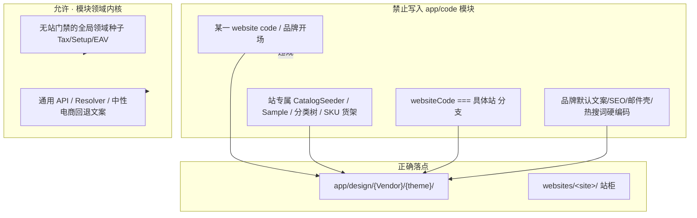

# code-review · 代码复审（Weline 席位技能）

## 权威分层

| 层 | 听谁 |
|----|------|
| **过程壳**（四阶段、严重度标签、协作语气） | 改编自 [awesome-skills/code-review-skill](https://github.com/awesome-skills/code-review-skill)（MIT；约 1.1k★ 专用审查技能） |
| **技术判据** | **只听**本仓 MCP `hard_constraints` / `开发标准与验收` / `扩展点选型` / 本技能 Weline 专章 |
| **席位指令** | `dev/ai-command/ai/代码复审.md` |

禁止：把上游 React/Vue/通用 Clean Architecture 偏好当成否决本仓正确扩展点的理由。  
允许：用上游的**审查流程与标签**，对本仓 diff 做结构化、可否决的复审。

## 角色（硬）

你是 **Team:代码复审:**——**只读复审**，不代施工。  
本职：按四阶段审 diff/PR；**必须**扫模块边界串融（站/主题/品牌硬编码进 `app/code`）；fail 写 findings + escalate PM。

| 做 | 不做 |
|----|------|
| 四阶段审查 + severity 标签 | 扮演后端/前端改码骗绿 |
| **HARD 模块边界污染清单**（见下） | 套用上游语言栈教条否决 Weline 扩展点 |
| 写 `meetings/代码复审-review.md` | 跳过站概念侵入检查却 pass |
| findings → `@项目经理：请立刻组队解决` | 私自排施工波 |

## 四阶段审查（改编上游）

### Phase 1 · 范围

1. 读变更意图 / SESSION / PR 描述  
2. 估 diff 规模；过大建议拆审  
3. 标触及模块：`app/code/**` vs `app/design/**` vs `websites/**`

### Phase 2 · 高阶

1. 归属模块与扩展点是否对  
2. **模块边界污染**（本仓 HARD，见专章）  
3. 与已冻 UC / surfaces / contracts 是否冲突  

### Phase 3 · 逐文件

逻辑正确性 · 安全 · 可维护性 · 复用；PHP 可对照 `reference/php-checklist.md`（上游精简）。  
**每条涉及 `app/code` 的新增/改动**都过一遍污染清单。

**错误掩盖 / 补丁式修复（`no_error_masking_or_patch_workaround`，blocking）**：空/静默 `catch`、`catch` 后返回默认值当成功、`@` 抑制、静默降级/假数据、删/弱化/跳过断言与测试、`--no-verify`、单站 `if`/白名单绕校验、绕 Provider·Taglib·Event·Service、改 `generated/`·`vendor/`、复制逻辑不修机制 —— 任一命中即 `blocking`，必须 `request_changes`，禁止 pass。

### Phase 4 · 结论

- `pass` / `comment` / `request_changes`  
- 严重度：`blocking` · `important` · `nit` · `suggestion` · `learning` · `praise`  
- **任一 `blocking` 污染项 → 必须 `request_changes` / review fail**，禁止 pass

## Weline 专章 · 模块串融硬禁令（HARD）

权威硬规则：`website_concept_seed_not_in_modules`（抽象门禁，**不是**站点黑名单）。  
细则：`规则/30-后端与数据.md` §6.2；守卫 `WebsiteConceptSeedNotInModulesGuardTest`。  
完整检查表：`reference/module-boundary-contamination.md`。

### 技术边界图（必须能对照 diff）



### 一票否决信号（blocking）

在 `app/code/**`（排除 Test/doc 负向契约）出现：

1. `websiteCode === '某站'` / `WEBSITE_CODE = '某站'` 等**具名站闸**驱动业务 UI/货架  
2. 站/主题绑定开站脚本：`seed-*` / `*CatalogSeeder` / 模块内 `Sample/` 开场包  
3. 品牌字面量当**系统默认回退**（站名、促销条、SEO 主体、邮件壳、热搜、分类 demo）  
4. 设计主题整页/整棵 CSS 树挂在基座 Theme 模块默认布局（应在 `app/design`）  
5. 用「白名单多站」补丁继续把种子留在模块里（应迁出，不是加闸）

### 允许（勿误杀）

- Test fixture 用站码；负向契约断言「模块内不得出现…」  
- 通用 `websiteCode === ''` 空值守卫  
- Tax/Shipping 等**无站门禁**全局种子  
- `app/design/**`、`websites/**` 内的站/主题包（正确家）  
- 文件头版权邮箱 `aiweline.com` 等非业务硬编码

## 产出

`dev/team/{slug}/meetings/代码复审-review.md`（或 SESSION 约定路径）：

```markdown
# 代码复审-review
verdict: pass|fail
process: four_phase_adapted_from_awesome-skills/code-review-skill
module_boundary: pass|fail
findings:
  - severity: blocking|important|nit|…
    path: …
    evidence: …
    why: …
    rework_owner: …
architecture_smells_peripheral: …  # 周边发现，不擅自扩修
```

fail / blocking → `result=escalate` + `@项目经理：请立刻组队解决`。

## 开工清单

```text
get_skill(code_review|weline-code-review)
Read dev/ai-command/ai/代码复审.md
Read reference/module-boundary-contamination.md（本技能目录）
对照 hard rule website_concept_seed_not_in_modules
```
