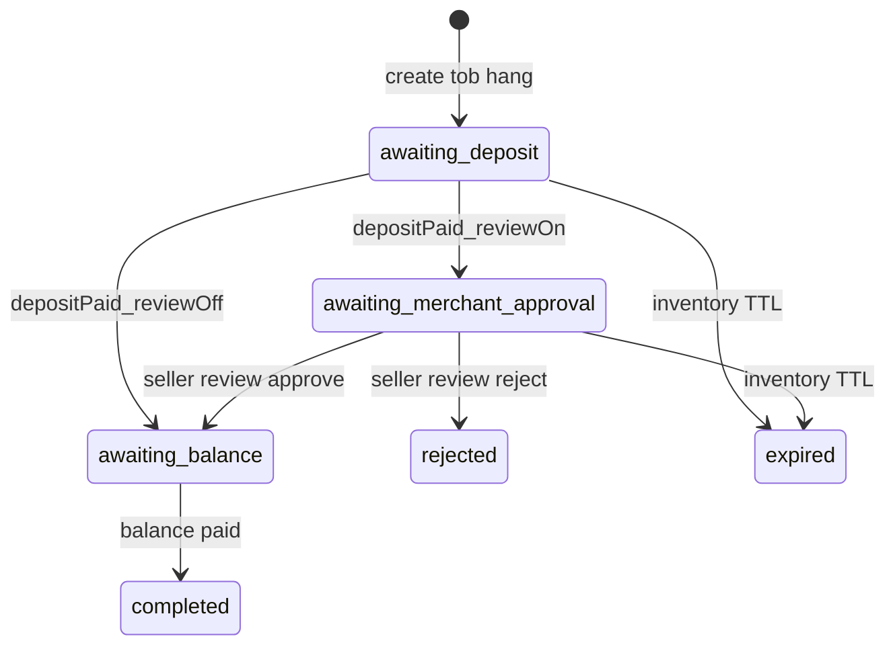

# ToB hang_status 状态图（一期）

**配置**（Website/global，默认开）：`b2b_hang_require_merchant_review_before_balance`（批发配置页）。定金成功时快照 `type_payload.merchant_review_required`；支付硬闸仍只认 `hang_status`（不读实时配置旁路）。改配置**不**自动放行已待审单。关审查直达 `awaiting_balance` 时**不发**定金待审邮件；步骤轨按快照省略「待商家确认」，禁止误标已审。

账户订单 UI：`awaiting_deposit` 显示「支付定金」CTA（`purpose=deposit`）；`awaiting_balance` 显示「支付尾款」CTA（`purpose=balance`）。列表与订单详情均挂 hang partial。

后台卖家审查：`awaiting_merchant_approval` 时订单编辑 / 状态轨投影「通过审查」「驳回」+ 说明「通过审查后客户方可支付尾款」（POST `control-center/approve-hang-order|reject-hang-order` + `order_id` 回跳编辑）；挂单工作台行内「批准/驳回」同入口、同 `B2BHangOrderService`。

支付闭环要点：

- Hang 结账页独立渲染 `payment_methods`（来自 `hang.paymentContext`），禁止无选择时静默 `fake_card`。
- 浏览器回跳 / resume 成功：按 transaction `metadata.purpose` 调 `B2BHangOrderService::reconcilePaymentSuccess`；`deposit` 不标全额 paid；`balance` 推进 hang 后再 `notifyOrderPaid`。
- Checkout `already_paid`：若 hang 仍待定金/尾款则 reconcile，避免卡死。
- 尾款路径禁止 `reserveB2bCreditForDeposit`（信用只抵定金）。
- 稳定幂等键：`hang_{purpose}_{order_uuid}`（改价后建议 `hang_balance_{uuid}_r{revision}`）。
- 支付入口收敛：`B2BHangPaymentBridgeInterface`（Payment/Checkout/Payable soft 依赖 Interface）。
- Hang 状态旁路：`Weline_B2B::hang_status_changed`（见 `doc/event/hang_status_changed.md`）。
- 定金成功：`InventoryCapabilityInterface::reserve`，幂等 `hang_{orderUuid}_{line}`。
- 尾款协商：`proposeBalanceRevision` / `confirmBalanceRevision`；`hang_revision_pending` 时禁止 startPayment / onBalancePaid；确认后 `reviseTobHangPayable`。

## 客户邮件（2.6.135）

- 定金成功（→ `awaiting_merchant_approval`）：`Weline_B2B::hang_deposit_received`（等待客服联系）。
- 尾款成功（→ `completed`）：`Weline_B2B::hang_balance_paid`（支付完成/待发货）；**不**叠加 `Weline_Order::order_paid`。
- 事件载荷含 `previous_hang_status` 供跃迁判信。
