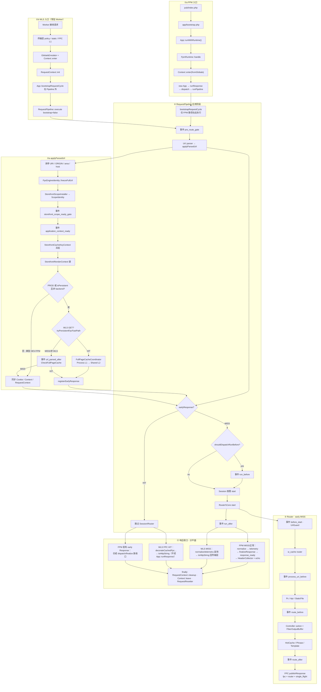

# 请求上下文逻辑图（权威主干）

> **硬规则**：`request_context_logic_diagram_must_read_and_sync`  
> 凡讨论 / 诊断 / 改动「请求上下文、RequestPipeline、FPC 早退、Scope 冻结、缓存袋分层、请求期事件」时，**必须先 Read 本页**。  
> 若改动使主干类 / 阶段顺序 / 缓存袋 / 关键事件与本图不一致，**必须同波更新本页**（禁止只改码留陈旧图）。

配套细约（本页不重复）：

| 主题 | 文档 |
|------|------|
| 请求内 Memo | [RequestContext请求级Memo约定.md](./RequestContext请求级Memo约定.md) |
| Fiber vs 进程袋 | [WLS-Fiber上下文与进程缓存边界.md](./WLS-Fiber上下文与进程缓存边界.md) |
| 缓存 API / 维度 | [缓存使用指南.md](./缓存使用指南.md) |
| 前置门禁事件 | [../event/app/请求前置门禁.md](../event/app/请求前置门禁.md) |

源码锚点：`FpmRuntime` / `WlsRuntime` / `App` / `RequestPipeline` / `FullPageCacheCoordinator` / `Router\Core`。

---

## 1. 两条入口（分叉后汇入同一应用管线）

| 平面 | 入口（**不同**） | 如何进 `RequestPipeline` |
|------|------------------|--------------------------|
| **FPM** | `pub/index.php` → `app/bootstrap.php` → `App::runWithRuntime()` → `FpmRuntime::handle` → `App::runResponse()` → `dispatch()` → `runPipeline()` | `new RequestPipeline()->execute($app)`（**默认** `bootstrapRequestCycle=true`） |
| **WLS** | 已常驻的 Worker → `WlsRuntime::handle`（**不**经 `pub/index.php` / `runWithRuntime` / `runResponse`） | 传输层策略后：`GlobalsEmulator` → `Context::enter` → `RequestContext::init` → **`$app->bootstrapRequestCycle()`** → `RequestPipeline::execute($app, bootstrap=false, …)` |

要点：

1. **共享的是应用阶段**（`RequestPipeline`），不是共享 FPM 入口壳。  
2. WLS 在进 Pipeline **之前**还会跑 Worker **传输层**：policy / static 短路 / **运输层 FPC L1**（见 `RequestPipeline` 类注释与 `WlsRuntime`「policy/static/FPC L1 already ran」）。  
3. WLS 的 `bootstrapRequestCycle` 在 Pipeline **外**显式调用；Pipeline 内再传 `bootstrap=false`，避免二次 bootstrap。

### 1.1 Pipeline 固定阶段（应用层）

```text
[WLS only · 传输层] policy / static / FPC L1（Pipeline 外）
→（FPM：Context::enter + 同步输入；WLS：已 enter + 已 bootstrap）
→ pre_route_gate
→ URL 解析与规范化（含 Scope / 缓存键冻结；条件性应用层 FPC）
→ early response?  —— HIT 则跳过下面
→ run_before（可跳过，见 §1.2）
→ lazy Session（可 defer）
→ Router / Controller（一次）
→ run_after（early/异常不触发）
→ Runtime finally / RequestResetter（各出口仍执行）
```

### 1.2 常见条件门（诊断必看）

| 门控 | 条件 | 后果 |
|------|------|------|
| 应用层 FPC 快查（`tryPersistentFpcFastPath` + `url_parsed_after`→`CheckFullPageCache`） | `(PROD \|\| Runtime::isPersistent()) && !is_backend` | **本机 FPM + DEV 店面**常整段跳过——不是「缓存坏了」 |
| `tryPersistentFpcFastPath` | 仅 `Runtime::isPersistent()` 且 GET 等 | FPM 永不走此快路径；WLS 先 Process L1 再 Shared |
| 运输层 FPC L1 | 请求的 `w_pg`（没有则 `pg/current`） | Nginx 与 WLS 只出这一代的页。没有该叶就进进程现烤。旧 token 目录保留，不拿来冒充。过期磁盘世代仍最多留 3 个，超过 7 天由 `FpcGenerationGc` 删除 |
| `run_before` | `shouldDispatchRunBefore()`；DEV 动态店面常 false；静态/媒体/维护/PROD 等 true | 图上勿当成每请求必跑 |
| Session eager start | 店面匿名 GET/HEAD 常 defer；QueryBin / scope-bootstrap 等另有豁免 | 与 FPC 早退无关时仍可能未开 Session |

---

## 2. 主干树（类 · 读参 · 缓存袋 · 事件 · 响应）



---

## 3. 缓存袋子分层

### 3.1 存储层级

| 层 | 名称 | 放什么 | 不放什么 |
|----|------|--------|----------|
| **R0** | 请求内 Memo（`RequestContext`） | 单请求事实快照 | 整袋词典 / HTML / 可跨请求共享结构 |
| **R1** | 请求袋（`DictionaryCacheNamespace::requestBag`） | 请求级数组缓存；不登记、不写 Store | 需要跨请求复用的 Worker L1 |
| **L1** | 命名进程袋（`processBag`）/ HotCache / FPC pointer（Worker 内） | Worker 常驻、显式命名、声明容量；WLS **传输层**亦可先摸 FPC L1 | 按 `request_id` 开永久共享键；匿名登记 |
| **L2** | Shared（Memory / durable File） | 跨 Worker 权威 | 请求围栏指纹冒充租户键 |
| **Disk** | FPC HTML / body 文件 | 大体量页面正文 | 业务私有会话态 |

Scope 未冻结（`request-fence`）：HotCache/FPC **不读不写** L1/L2，仅允许请求内 memo。

### 3.2 主干相关 `w_cache` 池（节选）

| identity | 用途 |
|----------|------|
| `fpc` | 全页缓存（environment_scoped） |
| `router` | 路由 + FPC 统一索引 |
| `single_flight` | 构建锁 |
| `phrase` / `i18n` / `currency` | 词典与语种货币 |
| `theme` / `theme_layout` / `weline_theme_*` | 主题 / chrome / nav / card |
| `product` / `website` / `eav` | 目录与筛选 HotCache |
| `system_config` / `config` | 配置 |
| `url_rewrite` | SEO 重写 |
| `session` / `cart` | 会话与购物车（按需） |

### 3.3 店面业务袋名（暖机 / hydrate）

| 袋 / 阶段 | Owner |
|-----------|--------|
| `StorefrontRenderContext::BAG_KEY` | Framework |
| chrome / partials header HTML | Theme `StorefrontHotCacheBagSeeder` |
| `locale_bag_prime` / `currency_bag_prime` | Product seeder |
| `StorefrontScopeHotCache` `rememberPolicy` 资源 | Framework + 归属模块 |

### 3.4 命名进程袋（L1）清单

| 袋名 / 前缀 | Owner | 失效方式 |
|-------------|-------|----------|
| `worker*`（11 个 `Parser::BAG_*`） | `Phrase\Parser` | `Parser::clearWorkerCaches` / 翻译发布 epoch |
| `globalDictionaryModuleBags` | `Phrase\GlobalDictionaryModuleBagCache` | 同上 + 压力卸载 |
| `i18n.taglib.*` / `i18n.model.*` / `i18n.active_locale.codes` | `I18n` | 目录变更观察者 / 进程重置 |
| `i18n.repository.locale.installed_active` / `i18n.repository.country.rows` | `I18n\Service\Repository` | `LocaleCatalogChangedClearActiveLocales` |
| `currency.local_names` | `Currency\Service\CurrencyLocalDescriptionService` | `clearProcessCache`（保存/删除本地名） |
| `shipping.region_names` / `street_names` / `postal_place_names` | `Shipping\Service\RegionLocalNameResolver` | `Shipping ProcessCacheResetter` |
| `websites.catalog.count`（L1+L2） | `Websites\Service\WebsiteCatalog` | `WebsiteCatalog::clearProcessCache` |

上下文获取固定顺序：**R0 → R1/L1 → L2 → DB miss**；目录/本地化仓库与 EAV 元数据不得在热路径重复读库。

---

## 4. 关键事件（时间序）

| 时机 | 事件 | 代表观察者 / 备注 |
|------|------|-------------------|
| URL/FPC 前 | `Weline_Framework::App::pre_route_gate` | Maintenance |
| Scope 冻结后 | `…::storefront_scope_ready_gate` | ScopeRateLimit |
| 同上 | `…::application_context_ready` | 使用方装应用输入 |
| 应用层 FPC 快查后 | `…::url_parsed_after` | `CheckFullPageCache`；**受 §1.2 门控** |
| FPC HIT | `Weline_Framework_Fpc::cache_hit_response` | Websites / Seo 装饰 |
| early 未命中且门控通过 | `…::run_before` | MediaManager 等；**可跳过** |
| Router 入口 | `Weline_Framework_Router::before_start` | UrlGuard |
| URI 前 | `…::process_uri_before` | StripCurrencyLocalePrefix |
| Controller 前后 | `…::route_before` / `route_after` | 扩展点 |
| 正常路由后 | `…::run_after` | early/异常不触发 |
| FPM 最终发出前 | `Weline_Framework_Http::response_ready` | Seo / Websites / Frontend；**WLS FPC HIT 主路径不保证同构经过** |
| 收尾 | `telemetry::request_collected` → `trace_flush` | 面板 / 监控 |

---

## 5. 出站分叉（按平面）

**应用层 HIT（earlyResponse）**

1. WLS：`tryPersistentFpcFastPath`（Process L1→Shared）和/或 `CheckFullPageCache` → `registerEarlyResponse`。  
2. Pipeline 见 early → 跳过 Session/Router/`run_after`。  
3. **WLS**：`decorateCachedFpcResponseForTelemetry` → `toHttpString` 回传输层。  
4. **FPM**：经 `runPipeline`/`dispatch` 族 normalize + telemetry + `finalizeResponse`（可含 `response_ready`）。  
5. 另：WLS **传输层**可能在进 Pipeline 前已用 FPC L1 短路（与应用层 HIT 分层）。

**MISS（SSR）**

`run_before`（若门控）→ Session（可 defer）→ `Router::start` → Controller + HotCache/Phrase → `publishResponse`（需 build lock）→ `run_after` → 各平面收口 → cleanup。

**假 miss 排查**：先看是否 **DEV-FPM** 未进 §1.2 应用层 FPC 门；再看 WLS 传输层 L1 vs 应用层 L1/Shared。

---

## 6. 本地化权威（路径语种 / 货币）

| 角色 | 落点 | 说明 |
|------|------|------|
| **写口** | `App::primeRequestRouteHints` / `synchronizeParsedLocalization`；`Url::rememberPathLanguage`；`RequestContext::locale` / `setWelineUserLang` | 路径段解析后写入 `route.language`（及同写 `env.user.lang` / `WELINE_USER_LANG`） |
| **访客 URI** | `applyParsedUrl` 取 `WELINE_VISITOR_REQUEST_URI`（再 ORIGIN / REQUEST） | 剥前缀后的工作路径可能已是 `/journal`；本地化必须从仍带 `/en_US/` 的访客路径判定 |
| **decode 与语种** | `Url::decode_url` / SEO rewrite | 可把 `/en_US/contact` 解成控制器路径 `/contact`（无语种段）。**禁止**把 decode 结果单独喂给 `synchronizeParsedLocalization`；同步/redirect/ORIGIN 身份用 **decode 前** 的访客 URI，路由仍用 `parse['uri']` / `REQUEST_URI` 的 decode 结果 |
| **无路径语种** | `synchronizeParsedLocalization` + `WlsRuntime::parseUrlLangCurrency` | **必须**从网站默认语言（`State::resolveWebsiteDefaultLanguage`）回填 `route.language`；禁止沿用上一 Fiber/请求遗留值或 Cookie |
| **有路径语种/货币** | `resolveLocalizationFromPathSegments` | 链接上已有的语言段、货币段直接响应该 URL，不 301。未启用的语种或货币也不跳转：正文用网站默认语，价格用网站默认货币。同一个弹窗里选已开通的项：两个都没有则左语种右货币，只有一个则只出那一列。该 URL `noindex`，canonical 指向同一路径的默认语种和默认货币 |
| **读口** | `WelineEnv::getLang()` / `getCurrency()` / `getLangLocal()`（及 `w_env('user.lang'|'user.currency')`），或 `RequestContext::locale()` / `currency()` | 优先 `route.*`；**禁止** `w_env_lang` / `w_env_currency` / `w_env_lang_local`、`State::getLang*`、`Cookie::getLang*`、偏好 Cookie、裸 `$_SERVER['WELINE_USER_*']`、`App\Env::get('user.lang')`；已废止的 `WELINE_URL_PATH_LANG` **不是**读口权威 |
| **已废止** | `WELINE_URL_PATH_LANG` 平行袋 | 禁止再写入；Worker 边界可 `forget`/`remove` 作脏键卫生 |

SEO peel / decode 只服务路由目标；路径语种权威仍是 **decode 前访客 URI** → `synchronizeParsedLocalization` 尽早写 RC。无前缀路径每次请求覆盖写网站默认语，Worker 不得把上一请求的中文/英文带进本请求。

---

## 7. 维护约定（与硬规则同效）

1. **读图触发**：请求上下文 / RequestPipeline / FPC 早退 / Scope 冻结 / 请求期缓存袋 / 上表事件——动手或下结论前 Read 本页。  
2. **改图触发**：改动上述主干阶段顺序、类职责、袋分层、事件名、入口分叉或早退条件时，同波更新本页 Mermaid 与表格。  
3. **禁止**：只在对话里另画一版当权威；把本页当会话草稿写进 `dev/session/` 却不回写；逻辑已变却宣称「图仍准」；把 FPM 与 WLS 入口画成同一条 `runWithRuntime` 壳。  
4. **AI-INDEX**：本文件为手写权威；模块 `AI-INDEX.md` 由生成器维护时，以 README / 本页互链为准，勿手改生成器产物冒充真相源。

---

## 8. 变更记录

| 日期 | 说明 |
|------|------|
| 2026-10-19 | 初版：从 App / RequestPipeline / FPC / Router 源码整理主干树并挂硬规则 |
| 2026-10-19 | 纠错：拆分 FPM/WLS 入口；补传输层 FPC L1；钉 DEV-FPM 跳过应用层 FPC、`run_before` 可跳过、HIT 收口分平面 |
| 2026-10-19 | 本地化：废止 `WELINE_URL_PATH_LANG`；路径语种只写/读 RequestContext（§6） |
| 2026-10-20 | 本地化：访客 URI 优先；无路径语种须网站默认回填 RC，禁止 Worker 遗留语种 |
| 2026-10-20 | 本地化：`applyParsedUrl` 禁止用 `decode_url` 结果做语种同步（SEO 解写可剥掉 `/en_US/`） |
| 2026-10-20 | 读口收敛为仅 Env + RequestContext；删除 Cookie/State 语言货币 get 门面 |
| 2026-10-20 | 进程袋统一：R0/R1/L1/L2 分层、命名袋清单、容量与 90% 水位；目录/本地化仓库 L1 去重读库 |
| 2026-10-20 | 未启用路径货币与语种一样留在原 URL：正文默认语、价格默认货币；同一弹窗按缺哪列展示 |
| 2026-10-23 | 运输层：进程收据世代过期时改读当前 html-disk 世代，不再直接放弃；过期世代最多 3 个，超过 7 天由定时任务清理 |
| 2026-10-23 | 页面世代：Nginx 与 WLS 只认请求上的 `w_pg`；没有该世代 FPC 则进进程。前端世代不符时用新 token 再请求 |
