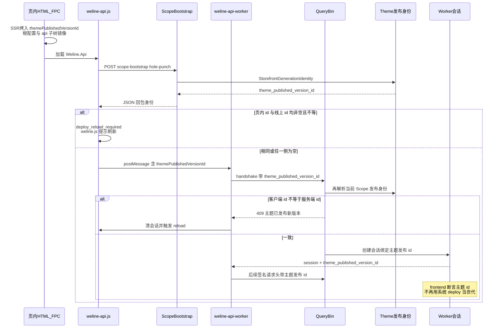
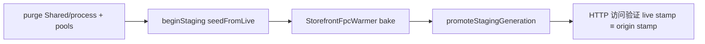

# 店面世代与前端工作流

> **开发者必读（维护店面 / Weline.Api / 发版 / 多站）**：不了解本架构，容易把系统 `deploy_version` 当成店面身份，导致「只发系统、主题未发」也 409 死循环，或改握手时弄断前后端勾连。  
> 权威：店面「是否要强制刷新 / Worker 会话是否同代」的身份，是 **当前请求 Scope 下已发布的主题版本**（`themePublishedVersionId`），**不是**全站系统 `deploy_version`。  
> **主题怎么开发 / 发布如何变成身份**：Theme [`架构/主题开发与店面世代.md`](../../../Theme/doc/架构/主题开发与店面世代.md)。  
> 协同：Theme [`ThemePublishedVersionRuntimeResolver`](../../../Theme/Service/ThemePublishedVersionRuntimeResolver.php)、Framework [`FrontendWorkerSessionService`](../../../Framework/Service/Query/FrontendWorkerSessionService.php)、Framework [`static-resource-versioning.md`](../../../Framework/doc/static-resource-versioning.md)「呈现世代」。

## 一、为什么要拆开两套戳

| 概念 | 权威落点 | 前端用途 |
|------|----------|----------|
| **店面世代身份** | Scope → 已发布 `ThemeScopeVersion` → `ThemeScopeGenerationCode` → `themePublishedVersionId`（编码，非裸数字 PK） | hole-punch 比对、handshake 验章、Worker 会话世代断言、`deploy_reload_required` |
| **系统 deploy 戳** | `var/deploy/current.json` / Env `deploy_version` | 静态资源 `?v=`、HMAC 签名材料、响应头观测；**不得**单独逼店面 reload |
| **worker_build_id** | `current.json` | Worker 脚本破缓 / 签名材料；店面会话在已绑主题发布 id 时**不以**它做世代踢会话 |

系统发版而主题未在该 Scope 重新发布 / upgrade 时：页内主题发布 id 与线上一致 → **不应** 409 死循环。  
主题在某一 Website/Scope **编辑器发布**（含回退到更旧密封版）后世代换码：Cookie、页烤戳、ScopeBootstrap、QueryBin 须读同一新 generation code；旧 HTML 仍烤旧码 → 与线上不一致 → 一次 reload 换新页。`theme:upgrade` / `clearAllThemeRelatedCaches` / Formal 编译 **只重暖产物，不换代**。

多站：A 站与 B 站各自 Scope 的已发布主题版本 id 不同 → 前后端各自一对一勾连，**禁止**全站共用一枚系统戳当身份。

**写出口统一（硬）**：一切店面世代信息（含 `weline_storefront_gen` Cookie）只能来自 `StorefrontGenerationIdentity` ← Theme Scope 已发布版本；`deployVersion` 可留作签名/静态破缓，**不得**参与 L1 世代键或换代比较。

## 二、前端工作流程（总图）

## 三、分步说明（浏览器侧）

### 1. 页面烤入身份

- 模板 [`view/blocks/header/base.phtml`](../../view/blocks/header/base.phtml) 经 `ThemePublishedVersionRuntimeResolver` 写入 runtime JSON：
  - 根上：`themePublishedVersionId` / `themePublishedVersion`
  - **`api` 子树必须镜像同一对字段**（与 `deployVersion` 镜像同模式），避免 `buildClientConfig` 只读 `config.api` 时握手带空/旧 id 误 409。
- 系统 `deployVersion` / `workerBuildId` 仍可烤入，仅供静态破缓与签名，不参与「要不要刷新」判定。

### 2. hole-punch（ScopeBootstrap）

- **谁发起（硬）**：只有 Worker 需要新 session 时才签章——`ensureSession` / handshake 因缺 Cookie 或 binding 失败 → `recoverScopeStamp`（或 `warmup({ forceHandshake: true })`）才 POST。
  - **禁止**页加载 eager `bootstrapScope` / `weline.js` DOM ready 主动打洞。
  - 普通 `warmup()`：**只握手**；SharedWorker 已有有效 session 则零网络签章。
- 客户端：`weline-api.js` 在 Worker 需求路径对 `/api/frontend/scope-bootstrap` POST（且本 tab 尚无有效签章记忆时）。
  - **200 + `expires_at`**：记长期签证；未过期（含 skew）前跳过再 POST。
  - **204 / rollout-off**：记 tab 级 `noStamp` 决策（**不是**伪造 Cookie soft TTL）；同 tab 后续 recover 跳过再 POST，直至 `forgetScopeStampKey`。
- 服务端：[`Controller/Api/ScopeBootstrap`](../../Controller/Api/ScopeBootstrap.php) 回包 **`theme_published_version_id`**（及展示名），**不再**用系统 `deploy_version` 做世代回包。
- 客户端比对：

  `payload.theme_published_version_id` ↔ `Weline.config.themePublishedVersionId`

  均非空且不等 → `error.code = deploy_reload_required`（历史 code 名保留）+ **Toast 提示并自动 reload**（`Weline.promptStorefrontGenerationRefresh`；**禁止** `window.confirm` / 原生弹窗）。

### 2b. 身份 Cookie + Vary（框架统一出口）

- 框架 [`StorefrontGenerationOutbound`](../../../Framework/Http/StorefrontGenerationOutbound.php) 在 `Response::prepareForEmission` **尝试** `Set-Cookie: weline_storefront_gen=<themePublishedVersionId>`（**非 HttpOnly**，供 JS 读）并 `Vary` **追加头名 `Cookie`**（禁止 `Vary: <id>`）。
- 共享匿名 FPC 仍走 [`SharedFpcSetCookieSuppress`](../../../Framework/Http/Fpc/SharedFpcSetCookieSuppress.php)：HIT/可共享壳不出脏 Set-Cookie，缓存不受影响；hole-punch / 非共享响应种上后，后续请求自带身份。
- [`weline.js`](../../view/statics/js/weline.js)：Cookie ↔ 页烤戳均非空且不等时，**以页烤戳为准同步 Cookie**（清 host/apex Domain 变体后再写），**禁止**因此 toast+reload。html-disk HIT 无法种 Cookie 时，错误 Scope 的粘滞 Cookie 不得对正确烤页形成刷新死循环。
- **真·主题已前进**：仅当 hole-punch / QueryBin 的**服务端** `theme_published_version_id` ≠ 页烤戳时，才 `promptStorefrontGenerationRefresh`（toast + reload）。
- 服务端解析 / promote 断言：html-disk 世代对齐走 **HTTP 访问验证**（访客路径 live ≡ 同 Host Origin），**禁止**靠 CLI 扩 Scope 探针列表（含「收渠道」）去对齐 Cookie/烤页。
- CDN：**Cache-Key（或等价）须包含 Cookie 名 `weline_storefront_gen`**，按 Cookie 值分版；源站只声明 `Vary: Cookie`。

### 3. Worker 配置与握手

- `buildClientConfig()` 从 **api 子树 → runtime 根** 回落读取 `themePublishedVersionId`，经 `postMessage` 交给 `weline-api-worker.js`。
- handshake 包体带 `theme_published_version_id`；请求头可带 `X-Weline-Theme-Published-Version-Id`。
- QueryBin [`assertClientThemeGenerationCurrent`](../../Controller/Api/QueryBin.php)：服务端再解析当前 Scope 发布 id；不等 → 409，文案「主题已发布新版本。请重新加载页面以继续。」。
- 会话创建：`FrontendWorkerSessionService` 写入 `theme_published_version_id`；后续 `validateSession` 在 frontend attested 且已存主题 id 时**只比主题发布身份**。

### 4. 会话复用

- Worker 内存槽复用条件以 **主题发布 id 一致** 为主（系统 deploy/build 变化 alone 不逼重握手）。
- 主题发布 id 变化、Scope bootstrap 轮换、会话过期 → 清槽并重新 hole-punch / handshake；不得静默降级未绑定会话。

## 四、关键符号与落点

| 层 | 符号 / 路径 |
|----|-------------|
| Theme 权威 | `ThemePublishedVersionRuntimeResolver::resolveGenerationIdentity()` |
| Frontend 桥 | `Helper/StorefrontGenerationIdentity` |
| 页头烤入 | `view/blocks/header/base.phtml`（根 + `api` 镜像） |
| hole-punch | `Controller/Api/ScopeBootstrap`、`view/statics/js/weline-api.js` |
| handshake / 验章 | `Controller/Api/QueryBin`、`view/statics/js/weline-api-worker.js` |
| 会话 | `Framework\Service\Query\FrontendWorkerSessionService` |
| 契约 | `QueryBinDeployGenerationContractTest`、`FrontendRuntimeThemeVersionContractTest`、`ThemePublishedVersionRuntimeResolverContractTest` |

## 五、禁止事项（not_to_do）

1. **禁止**用全站 `deploy_version` / `X-Weline-Deploy-Version` 单独触发店面 `deploy_reload_required`。
2. **禁止**「系统 deploy + 主题版本」拼成复合店面身份。
3. **禁止**在 Runtime / 编排层硬编码 Website 或主题 slug 当世代键。
4. **禁止**业务页手写 fetch 绕过 `Weline.Api` 自己比戳（见 [`Weline.Api使用指南.md`](../Weline.Api使用指南.md)）。
5. 后台（backend attested）会话仍可走 deploy/build 断言；本文件只约束**店面** frontend 世代。

## 六、与 FPC / 系统发版的关系

- FPC 可继续出站写 `X-Weline-Deploy-Version`（系统戳观测）；客户端**不**据此决定 reload。
- 主题**编辑器发布**后应由 Theme 失效链路（`ThemeRuntimeCacheCleaner` 等）按新 generation code 重暖 HTML；编译/清缓存只重暖当前码。旧页撞上新码时走上述 reload 自愈。
- 细节见 Framework [`static-resource-versioning.md`](../../../Framework/doc/static-resource-versioning.md)、Theme [`runtime-cache-invalidation.md`](../../../Theme/doc/runtime-cache-invalidation.md)。

### 6.1 发布 → html-disk 原子闭环（硬）

主题 Scope 发布 / staging promote / `clearAllThemeRelatedCaches` 必须保证受影响 Scope 的 **html-disk HIT 烤入身份** 与线上 `StorefrontGenerationIdentity::currentVersionId()` 一致。

1. **先清指针**：Shared / process FPC、主题池、CDN 全页 purge（禁止在 warm 之后再清 Shared 把新烤页打空）。
2. **再 staging→暖→promote**：`FpcHtmlDiskStore::beginStagingGeneration(true)` → warmer → `promoteStagingGeneration`；失败 `abandon` 保 live。
3. **断言（访问验证，硬）**：promote 后对每个 warm Host 走真实 HTTP：访客路径（无 pierce / 无 FPC bypass）读 live 页 `themePublishedVersionId`；同源站 Origin 路径（pierce + bypass）读当前应烤身份。**空戳 = 草稿/从未编辑器发布**（与 Theme resolver「空 id 跳过强制」一致）：live+origin 皆空或 origin 不可验证 → 软过（日志 `draft_never_published`）；origin 非空而 live 空、或两边非空且 live ≠ origin → fail-closed。若响应带 `weline_storefront_gen` Cookie，须与页戳一致。**禁止** CLI 直调 `collectAcceptableStorefrontGenerationIds()` / 单一 `currentVersionId()` / 仅扫磁盘 html 与进程内 Scope 探针集合比对（易把 Global 脏 selection 当成 expected，误杀 Channel/Store 烤入）。
4. **QueryBin**：空 client stamp 与非空 server **不等** → 409；**禁止**「空=跳过」被 e2e neutralize 滥用成清戳产品路径。
5. **not_to_do**：禁止 e2e neutralize 当正式产品自愈；禁止用系统 `deploy_version` 绑店面世代；禁止在 `WlsRuntime` 硬编码站/主题；禁止用「收渠道进探针列表」代替访问验证。

落点：`ThemeRuntimeCacheCleaner::rebuildFpcViaStagingWarmPromote` + `assertPromotedHtmlDiskMatchesStorefrontGeneration`（`StorefrontWarmupHttpClient::requestTarget`）；契约 `ThemePublishHtmlDiskGenerationAtomicContractTest`。

## 七、开发者如何维护（操作手册）

### 7.1 改代码前先认清身份轴

1. 要动 **reload / handshake / Worker 会话世代** → 只动 `themePublishedVersionId` 这条轴（Theme Resolver → Frontend 桥 → JS → QueryBin → Session）。
2. 要动 **静态 `?v=` / 系统发版观测** → 动 `deploy_version` / `worker_build_id`，**不要**再接到 `deploy_reload_required`。
3. 新 Website / 新 Scope / 新主题发布 → 自然形成新的一对一身份；不要发明全站第二套戳。

### 7.2 常见维护场景

| 场景 | 正确做法 | 错误做法 |
|------|----------|----------|
| 只发系统代码 | 更新 `deploy_version`；主题未发则页内主题 id 不变，店面不应 409 | 用系统戳逼 reload / 踢 Worker 会话 |
| 主题编辑器发布某站（含回退到更旧密封版） | 走 Theme 发布 + Scope 缓存失效；页烤 / Cookie / Bootstrap 跟**当前**已发布 id；FE 用 `!==` / `strcasecmp` 相等比对（可回退） | 只 bump 全局 deploy；或按版本号大小当「新世代」 |
| `theme:upgrade` / 清主题相关缓存 / Formal 编译 | 按当前 Scope **已发布**主题版本重暖 FPC/产物；**世代 id 不变**（世代≡主题版本，仅编辑器发布换代） | 清缓存旁路 `advancePublished*` 造版本；或用 deploy 当 L1/换代键 |
| 排查线上 409 环 | 比页内 `themePublishedVersionId` 与 ScopeBootstrap/QueryBin 回包 id；查 FPC 是否仍吐旧 HTML | 只看 `X-Weline-Deploy-Version` 头就下结论 |
| 改页头 runtime JSON | **根配置与 `api` 子树同时镜像**主题发布字段（同 deployVersion 镜像） | 只写根、不写 `api` → soft-query 握手 id 空/旧 |
| 加业务请求 | 走 `Weline.Api.*`；世代由框架链路处理 | 业务页手写 fetch 自己比戳 |

### 7.3 回归最小集

改本链路后至少跑：

- `QueryBinDeployGenerationContractTest`
- `FrontendRuntimeThemeVersionContractTest`（含 api 子树镜像）
- `ThemePublishedVersionRuntimeResolverContractTest`
- 真机：系统发版不杀（UC1）；主题发布后旧页一次 reload（UC2）；两站会话不串（UC3）

### 7.4 文档入口（给新同事）

1. 本文（Frontend 架构）
2. Theme 开发与发布身份：[`../../../Theme/doc/架构/主题开发与店面世代.md`](../../../Theme/doc/架构/主题开发与店面世代.md)
3. [`../Weline.Api使用指南.md`](../Weline.Api使用指南.md)（业务请求边界）
4. [`../README.md`](../README.md)（模块总入口）
5. Framework 呈现世代表：[`../../../Framework/doc/static-resource-versioning.md`](../../../Framework/doc/static-resource-versioning.md)
6. Theme 发布失效：[`../../../Theme/doc/runtime-cache-invalidation.md`](../../../Theme/doc/runtime-cache-invalidation.md)
