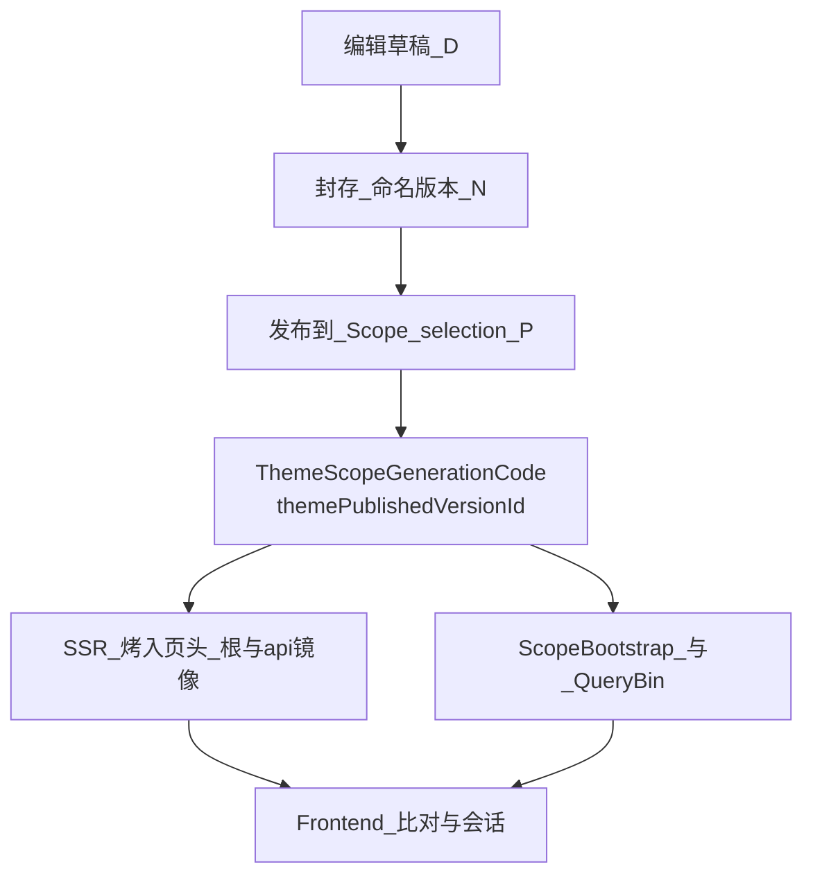

# 主题开发与店面世代（Theme → Frontend）

> **开发者必读**：主题怎么开发、怎么发布，直接决定店面「认哪一版身份」。  
> Theme 侧权威是 **Scope 已发布 `ThemeScopeVersion`**（`themePublishedVersionId`）；Frontend 用同一枚身份做 hole-punch / QueryBin / Worker 勾连。  
> 前端完整工作流：[`../../Frontend/doc/架构/店面世代与前端工作流.md`](../../Frontend/doc/架构/店面世代与前端工作流.md)。  
> 版本模型：[`../version-control/README.md`](../version-control/README.md)。  
> 开发总指南：[`../开发/Theme开发总指南.md`](../开发/Theme开发总指南.md)。

## 1. 主题开发三态（先判再写）

与总指南 / `dev/ai-command/ai/主题开发.md` 一致，动手前声明 `work_mode`：

| work_mode | 改什么 | 店面世代影响 |
|-----------|--------|----------------|
| `default_theme` | `Weline_Theme/view/theme/**` 默认源 | 改源后须 `theme:upgrade` / 固化链路；**访客世代仍跟「已发布版本」**，未发布不等于线上已换代 |
| `design_theme` | `app/design/{Vendor}/{theme}/**` 继承覆盖 | 同上；禁止改 `app/code` 源头部件「一改全站」 |
| `theme_module_runtime` | Theme PHP 运行时 / Resolver / 发布失效 | 动世代权威或失效时必须与 Frontend 勾连文档对齐 |

**硬禁**：`design_theme` 不得 mutate 源头 widget；`theme.css` 只定架构不定品牌风格壳（见总指南与 `theme-css-architecture-vs-style.md`）。

## 2. 发布如何变成店面身份

1. Owner = `(theme_id, canonical_scope, store_mode, area)` 上的 `ThemeScopeVersion`。
2. 访客正式态读 **当前已发布 P**；`ThemePublishedVersionRuntimeResolver::resolveGenerationIdentity()` 按请求 Scope 祖先链取 published。
3. 解析结果写入店面 HTML（`themePublishedVersionId`）并回给 Frontend；**系统 `deploy_version` 不是这条轴**。
4. 多 Website：A 站发布版本 id=6、B 站发布版本 id=22 → 两套身份，前后端各自一对一；禁止全站一枚系统戳。

## 3. 主题开发日常怎么维护

| 你在做的事 | 正确期望 | 错误期望 |
|------------|----------|----------|
| 只改 design/默认主题源，未点发布、未 upgrade | 编辑器/预览可见；**正式访客世代 id 不变** | 以为保存草稿线上就会 409 换代 |
| 运营后台可视化编辑器 **点击发布**（含发布到**更旧**的密封版 = 回退） | 该 Scope **当前**已发布行 → `ThemeScopeGenerationCode`（`t{theme}.{area}.{store}.{scopeFp}.v{n}`）= 店面世代；Cookie / 烤戳 / Bootstrap 跟该码（可回退） | 编译/升级/清缓存旁路 `advancePublished*` 造版本；用版本号单调递增当「新世代」；把数字 PK 当世代语义 |
| Formal compile / solidify / `theme:upgrade -f` / `clearAllThemeRelatedCaches` | **只读取**当前已发布版本（及其 generation code）去编译/重暖产物；**世代码不变** | 把清缓存当成发版、旋转 `themePublishedVersionId` |
| 在某 Website/Scope 编辑器发布主题版本 | 该 Scope 新 `themePublishedVersionId`；旧 FPC HTML 应失效或撞 id 后 reload | 只 bump 系统 deploy 指望店面换代 |
| 只发框架/系统代码 | 系统戳可变；**主题未发则店面不应因 deploy 409** | 把 `X-Weline-Deploy-Version` 当店面身份 |
| 排查「站点已更新」死循环 | 比页内主题 id vs ScopeBootstrap 回包 vs Cookie `weline_storefront_gen`；查 Theme 发布与 FPC | 只盯系统 stamp |

发布后缓存/失效：[`../runtime-cache-invalidation.md`](../runtime-cache-invalidation.md)（`ThemeRuntimeCacheCleaner`、Scope 定向清、禁止已知 typed Scope 时乱 `clearNonGlobalCaches(null)`）。

## 4. 与 Frontend 的分工（勿越界）

| 模块 | 负责 | 不负责 |
|------|------|--------|
| **Theme** | 版本/草稿/发布、Resolver、布局固化、主题静态、发布失效 | 手写 QueryBin 协议、业务页 fetch |
| **Frontend** | 页头烤入镜像、hole-punch、Worker handshake、会话世代断言、`Weline.Api` | 发明第二套主题版本轴 |
| **Framework** | Worker 会话存储、FPC/deploy 静态戳 | 用系统 deploy 冒充店面世代 |

Theme 开发者改完发布链路或 Resolver 时：同步核对 Frontend [`店面世代与前端工作流.md`](../../Frontend/doc/架构/店面世代与前端工作流.md) §七维护表。

## 5. 推荐阅读顺序（Theme 开发）

1. [`../开发/Theme开发总指南.md`](../开发/Theme开发总指南.md) — work_mode / 布局 / 部件  
2. **本文** — 发布如何变成店面身份  
3. [`../version-control/README.md`](../version-control/README.md) — 草稿 / P / 发布  
4. [`../preview-and-runtime-modes.md`](../preview-and-runtime-modes.md) — 预览三态  
5. [`../runtime-cache-invalidation.md`](../runtime-cache-invalidation.md) — 发布失效  
6. [`../../Frontend/doc/架构/店面世代与前端工作流.md`](../../Frontend/doc/架构/店面世代与前端工作流.md) — 浏览器勾连  
7. [`../../Frontend/doc/Weline.Api使用指南.md`](../../Frontend/doc/Weline.Api使用指南.md) — 业务请求边界  

## 6. 世代写出口（必须同源）

权威：`(theme_id, scope, store_mode, area)` 上已发布的 `ThemeScopeVersion` → `ThemeScopeGenerationCode` → `ThemePublishedVersionRuntimeResolver` → Frontend `StorefrontGenerationIdentity`。

线身份格式：`t{themeId}.{area}.{storeMode}.{scopeFp12}.v{versionNumber}`（确定性；同版本号回退同码）。展示名 `version_name` 不当世代键。过渡期 QueryBin acceptable 仍兼收遗留数字 `version_id` 字符串。

| 出口 | 必须读该桥 |
|------|------------|
| Cookie `weline_storefront_gen` | `StorefrontGenerationOutbound` ← Identity（generation code） |
| HTML 烤戳 / `api` 子树 | `base.phtml` ← Resolver（generation code） |
| ScopeBootstrap / QueryBin / Worker 会话 | `theme_published_version_id` ← Identity |
| FE 比较 / L1 / reload | 只比 `themePublishedVersionId`（字符串相等，可回退） |

禁止旁路 `setCookie(weline_storefront_gen, …)`；禁止用 FPC `generations/*` 目录名或系统 deploy 写入上表任一槽位。

## 7. not_to_do

1. 禁止用系统 `deploy_version` 冒充主题发布身份。  
2. 禁止「系统 + 主题」拼复合店面世代键。  
3. 禁止未发布且未 upgrade 就假定正式店面已换代。  
4. 禁止在 Theme 文档里教业务页手写 fetch 比戳。  
5. 禁止 design 模式改 `app/code` 源头部件当「快捷修复」。  
6. 禁止 `advancePublishedStorefrontGeneration` 走会改草稿指针的裸 `createRevisionFrom`。  
7. **硬**：店面世代 ≡ 主题已发布版本；禁止编译/升级/固化/清缓存调用 `advancePublished*`；仅编辑器发布换代。  
8. **硬**：世代可回退——换代判据是「当前 Scope 已发布 **generation code** 是否变成另一个」（相等则无事），**禁止**假定码/版本号只增不减。FE hole-punch / QueryBin / Worker 会话均按字符串相等比对。  
9. **硬**：世代线身份必须走 `ThemeScopeGenerationCode`；禁止 Resolver 再写裸 `(string)version_id` 当权威（acceptable 过渡兼收除外）。  
10. **硬**：`ThemeRuntimeLayoutResolver::resolvePublishedReleaseInfo` 是 **布局 workspace release 轴**（`publishedReleaseId`），禁止再命名/返回 `themePublishedVersion*`；禁止把它当店面世代喂 FE。  
